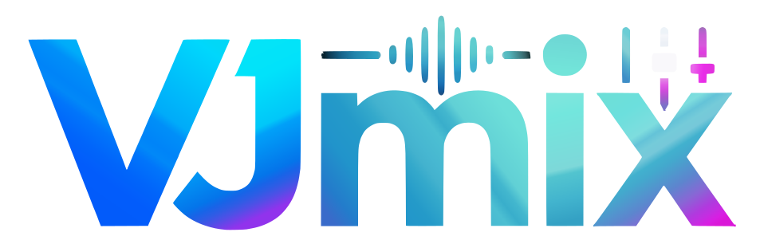

<p align="center">
  
</p>

# VJmix

VJ controller for **Vimix**, driven by **viOSC**.

An 8×8 step sequencer that fires OSC messages to Vimix in sync with the music
(VU/BPM analysis, MIDI clock, band peaks), with a thumbnail grid, a **Mapper**
that maps an origin to a destination (a live Vimix property, an audio band or a
MIDI/Leap control to Vimix, a controller LED or third-party OSC), an **I/O
Monitor** that shows the MIDI and OSC traffic in both directions, and optional
MIDI controller support (Novation Launchpad profiles included).

[](https://youtu.be/dtzOFJbv7ko)

## Quick start — AppImage (Linux)

The easiest way to run VJmix on Linux is the self-contained AppImage: a single
file with Python, all libraries and the app bundled — **no Python, no pip, no
root** (PortAudio included, so no `libportaudio2` package is needed). Starting
with release **1.0.0**, download
`vjmix-<version>-x86_64.AppImage` from the
[GitHub Releases](https://github.com/lupin3rd/VJmix/releases) page, then:

```bash
chmod +x vjmix-1.1.0-x86_64.AppImage
./vjmix-1.1.0-x86_64.AppImage
```

### Where your data lives

- Config: `~/.config/vjmix/vjmix_config.json` (honors `$XDG_CONFIG_HOME`).
- Controller profiles: drop custom `*.json` profiles into
  `~/.config/vjmix/controllers/` (the Launchpad profiles ship built-in).
- Projects: the Open/Save dialogs default to `~/.config/vjmix/projects/`; you
  can save anywhere you like.

## Quick start — from source (developers)

Requires Python 3.13 and **PortAudio**, which `sounddevice` loads from the system
at import time (the AppImage carries its own, a source checkout does not):

```bash
sudo apt install libportaudio2      # Debian/Ubuntu (Fedora: dnf install portaudio)
python3.13 -m venv .venv
.venv/bin/pip install -r requirements.txt
.venv/bin/python vjmix.py
```

## Requirements

- [viOSC](https://github.com/lupin3rd/viosc) **0.8.0+** (the daemon that bridges
  VJmix and Vimix). From 1.1.0 the link is HTTP-first: `/vimix/*` commands still
  ride OSC, while the state table arrives as a snapshot (`GET /state`, revision +
  ETag) plus a delta stream (`GET /events`, Server-Sent Events) and the Mapper
  declares what it needs with `POST /interest`. An older viOSC keeps working
  through the deprecated `/viosc/*` lanes.
- Vimix
- (optional) a Novation Launchpad MK1/MK2/MK3 for pad control

## License

GPL-3.0 — see [LICENSE](LICENSE).
